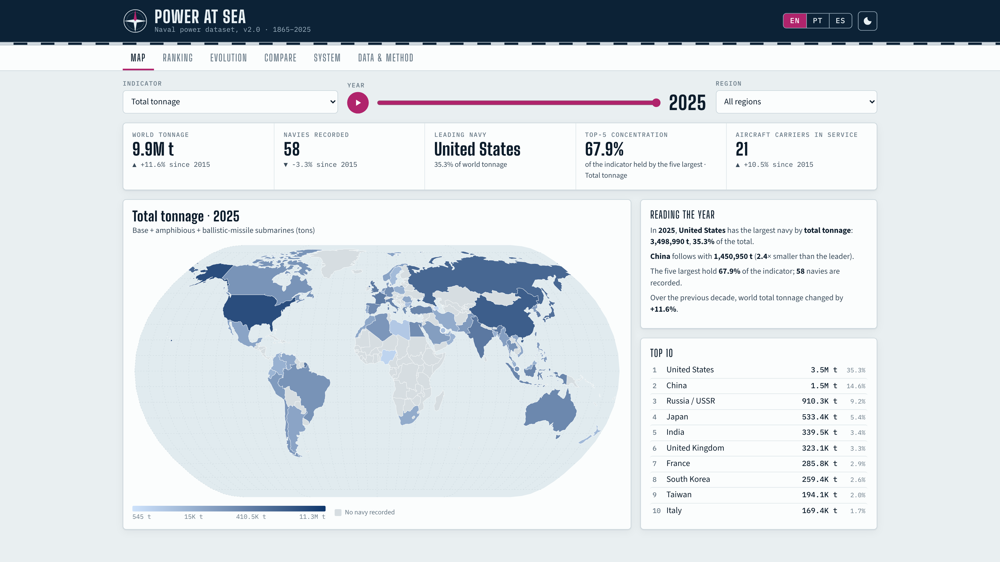

# Power at Sea Atlas

Interactive dashboard for the **Power at Sea** naval power dataset, version 2.0 (Crisher 2026, building on Crisher & Souva 2014), covering 80 navies from 1865 to 2025. The interface is available in **English, Português and Español**.

Painel interativo da base **Power at Sea** v2.0 (Crisher 2026, a partir de Crisher & Souva 2014), com 80 marinhas de 1865 a 2025, em inglês, português e espanhol.



Presentation images (3840×2160, 16:9) in `docs/presentation/`: `home-pt.png`, `home-en.png`, `home-es.png`, `home-pt-dark.png`.

## Views

| Tab | What it shows |
|---|---|
| Map | World choropleth of the selected indicator for any year, with a timeline player, a reading of the year and the top 10 |
| Ranking | Animated bar ranking by region, top 10 / 20 / all |
| Evolution | Time series for up to 8 navies, presets (naval races, Cold War, P5), log scale and year range |
| Compare | Two navies side by side: profile, fleet composition and history |
| System | Regional shares, concentration, capital ships, large warships and number of navies |
| Data & method | Sortable, searchable table for any year, codebook, method notes, citation and downloads |

Indicators: total tonnage (including ballistic-missile submarines, as in the v2.0 descriptive tables), share of world tonnage, base / base+assault / amphibious / SSBN tonnage, navy strength, ship count, and counts of carriers, battleships, SSN, diesel submarines, SSBN, assault ships, LPD/LSD and ships above 5,000 and 10,000 tons.

## Run locally

It is a static site with no build step:

```sh
python3 -m http.server 8000
# open http://localhost:8000
```

To publish with GitHub Pages: *Settings → Pages → Deploy from a branch → `main` / root*.

## Rebuild the data

`assets/js/data.js` and `data/poweratsea_v2.csv` are generated from the original Stata file:

```sh
pip install pandas
python3 scripts/build_data.py path/to/world-atlas/countries-110m.json   # map file optional
```

Country names (EN/PT/ES) and the mapping of historical states to modern map polygons live in `scripts/build_data.py`.

## Files

- `data/source/` – original release: dataset (`.dta`), SUR model data, codebook appendix (PDF), READ_ME and Stata do-files
- `data/poweratsea_v2.csv` – flat export used for downloads
- `assets/js/i18n.js` – all interface text in the three languages

## Citation

Dataset v2.0: Crisher, Brian. 2026. “Power at Sea 2.0.” Harvard Dataverse. https://doi.org/10.7910/DVN/CW50N0.

Original article: Crisher, Brian Benjamin, and Mark Souva. 2014. "Power at Sea: A Naval Power Dataset, 1865–2011." *International Interactions* 40(4): 602–629.

Map boundaries: Natural Earth via [world-atlas](https://github.com/topojson/world-atlas). Charts: [d3.js](https://d3js.org).
